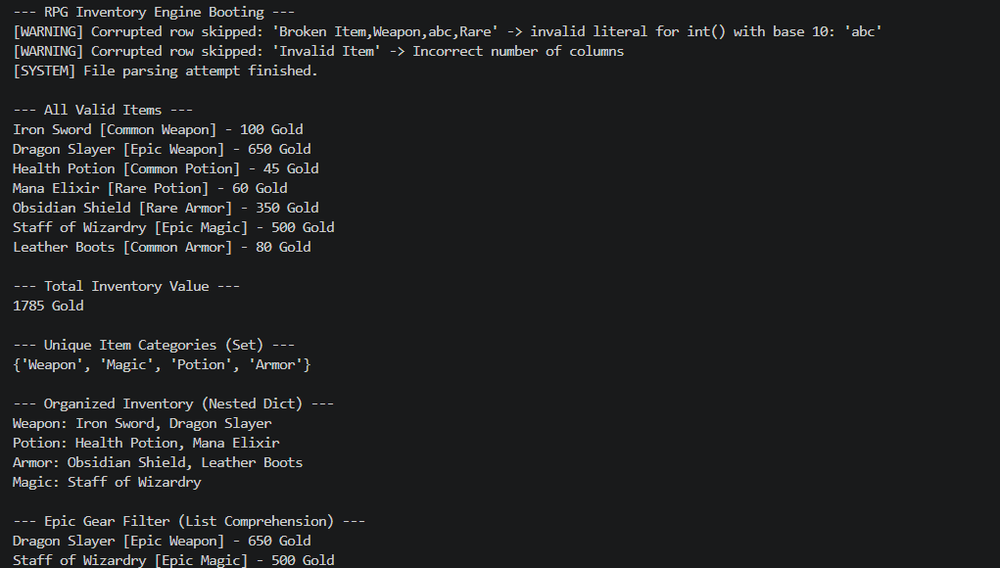

# Week 2: Advanced Python & Data Structures
**IEEE LGU AI/ML Cohort One**  
**AI/ML Leads:** Abdullah Faisal & Alina Irshad  

## 1. Project Overview
The RPG Inventory Engine is a simulated game inventory system. It parses external save data containing fictional items, categorizes gear using advanced data structures, and safely bypasses corrupted save files without crashing.

## 2. Concepts Implemented
- **Object-Oriented Programming (Classes, Objects, Encapsulation, Inheritance):** Implements Inheritance where specific child classes (`Weapon`, `Potion`, `Armor`) inherit core properties from a base `Item` class.
- **File Handling (Reading external data dynamically):** Dynamically opens and reads data from the external `data/items.csv` file.
- **Error & Exception Handling (try/except/finally with corrupt data handling):** Safely handles intentional corrupt rows (like "abc" gold values or missing columns) using `try/except/finally` so the game engine does not crash.
- **Data Structures (Lists, Sets, Tuples, Dictionaries):** Uses a `Set` to extract unique categories and a Nested Dictionary (`{"Weapon": ["Iron Sword", "Dragon Slayer"]}`) to organize the player's backpack.
- **List / Dictionary Comprehension:** Employs list comprehensions to quickly filter and extract only "Epic" rarity items from the massive inventory list.

## 3. How to Run the Program
python main.py

## 4. Dataset Information
The dataset is an external file named `items.csv` containing 9 records. It deliberately includes two corrupt test cases to prove error handling: a row with missing columns (`Invalid Item`) and a row with a text string in the integer gold column (`Broken Item,Weapon,abc,Rare`). The program catches both exceptions.

## 5. Execution Screenshots & Proof
